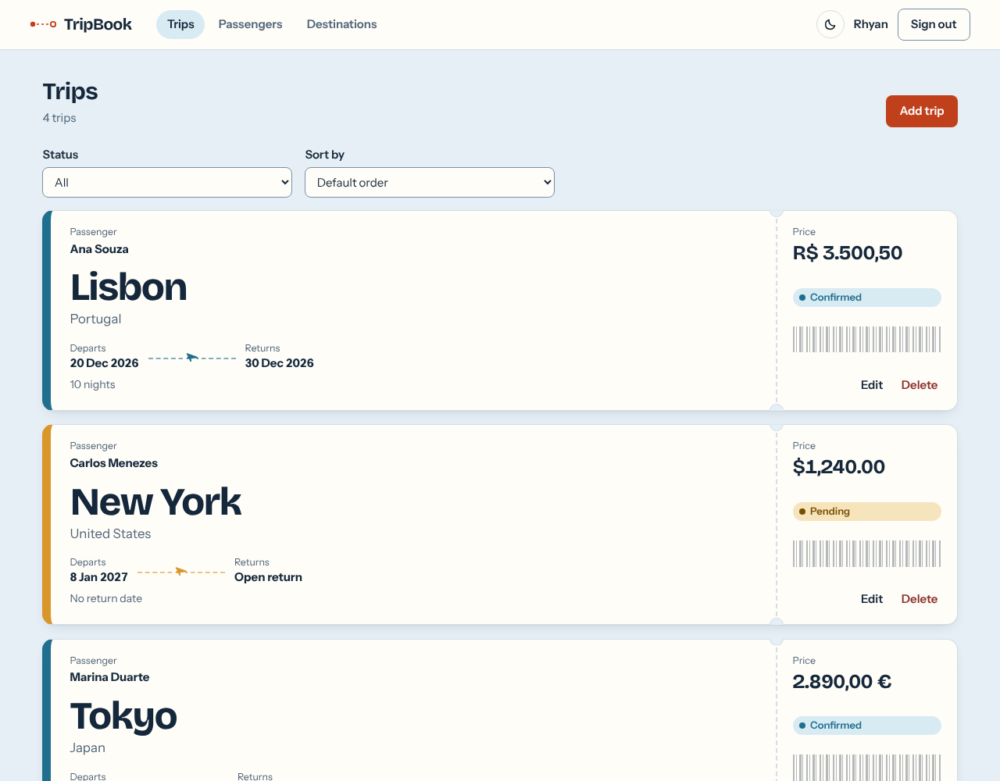
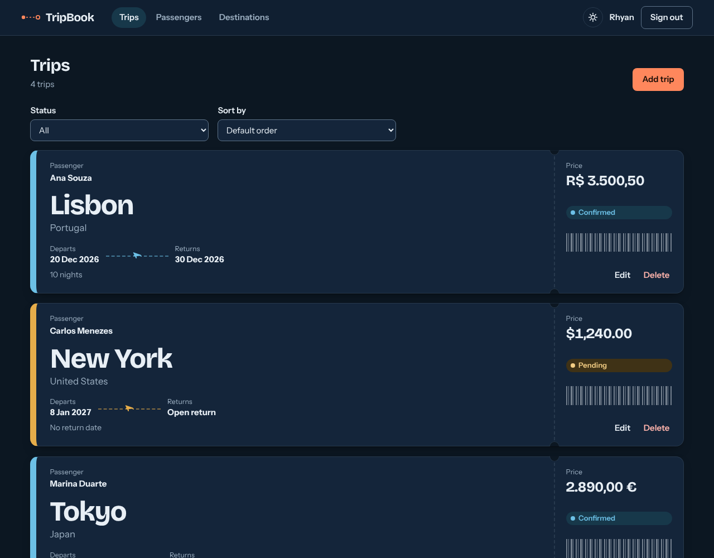
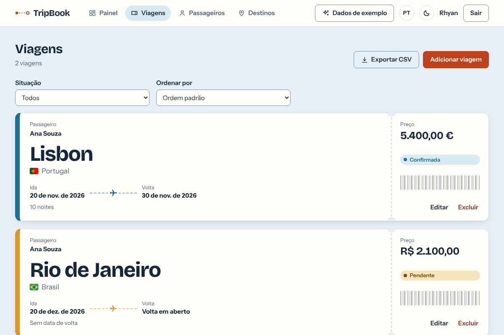
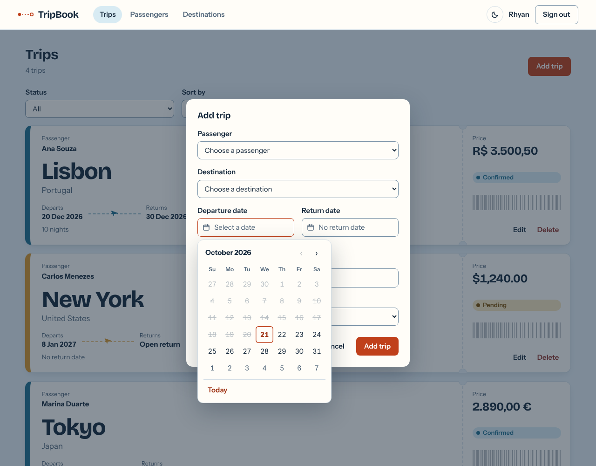
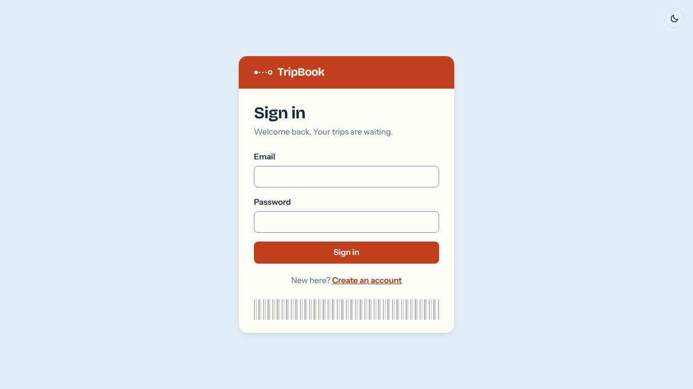
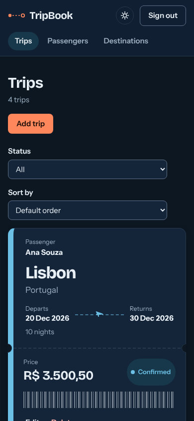

# TripBook


Full-stack app for managing trip bookings: passengers, destinations and the trips that connect them. A Spring Boot REST API with MySQL, and a React front-end where every trip is shown as a boarding pass.

**Live demo:** https://tripbook-api-9dv5.onrender.com

The project started as a university assignment (Object-Oriented Programming, CEUB, tag `v1.0-entrega`) and was evolved into a portfolio project: DTOs, pagination, automated tests, continuous integration, JWT authentication, per-account data, a React front-end with light and dark themes, and deployed online with Docker on Render + Aiven MySQL.

## Screenshots

The images below use sample data.

| Light | Dark |
|-------|------|
|  |  |

The same screen in Brazilian Portuguese:



| Calendar date picker | Sign-in | Mobile |
|----------------------|---------|--------|
|  |  |  |

## Features

- Full CRUD for passengers, destinations and trips
- Each trip links one passenger to one destination
- Business rules: dates must be real calendar dates (no 31 November), a trip cannot start or end in the past, the return date cannot be before the departure date, and the passenger and destination must exist. Editing a trip keeps its dates even after they have passed, so a trip that already happened can still be corrected
- A destination that still has trips cannot be deleted; deleting a passenger also deletes their trips
- A destination (city and country, ignoring letter case and extra spaces) can be registered only once; a repeat returns `409`
- Pagination, sorting and filtering on every list endpoint
- Each account sees only its own passengers and trips (destinations are a shared catalog)
- Each trip has a price in BRL, USD or EUR, shown in that currency's own format
- Accounts with sign-up and sign-in: passwords stored as BCrypt hashes, stateless JWT access tokens, every `/api` route protected except register and login
- Input validation with clear error messages and a single, consistent error format
- Interactive API documentation with Swagger UI
- React + TypeScript front-end: trips shown as boarding passes, sign-in styled as a check-in pass, paginated, filterable and sortable lists and forms for every resource
- Dates are picked from a calendar (never typed); days before today, and return days before the departure, cannot be chosen
- The passenger birth date uses the same calendar, with month and year selects for dates far in the past; only days before today can be chosen
- Destination countries are chosen from a searchable list (English or Portuguese names) and shown with their flag, in the destinations table and on every boarding pass
- Navigation icons for Trips, Passengers and Destinations, and a plane on the boarding pass route line
- Dashboard as the first screen: trips per status, money booked per currency (currencies are never added together), the next departures and the most visited destinations, all computed by the database with group-by queries (`GET /api/dashboard`)
- Sorting trips by price groups them by currency first, since 100 EUR and 100 BRL are not the same amount
- English and Brazilian Portuguese: a switch in the top bar (and on the sign-in page) changes every text, the dates, the calendar, the country names and the API's error messages. The choice is remembered; first visits follow the browser language. Texts live in `frontend/src/i18n` (`en.ts` is the reference and the compiler requires `pt.ts` to have the same keys)
- Loading placeholders (skeletons) instead of an empty screen, and a notice on the sign-in page when the session expired
- Dependabot opens weekly pull requests for Maven, npm, GitHub Actions and Docker updates
- Export every trip as a CSV file (opens in Excel with accents intact; text that looks like a spreadsheet formula is neutralised)
- A "Sample data" button adds example destinations, passengers and trips to the signed-in account; running it again adds nothing
- Light and dark themes: follows the operating system by default, with a toggle that remembers the choice
- Automated tests on both sides (back-end: unit, web layer, repository and end-to-end; front-end: components and API client) running on every push through GitHub Actions

## Tech stack

- Java 17
- Spring Boot 4 (Web MVC, Data JPA, Validation, Security with OAuth2 resource server for JWT)
- Hibernate / JPA, MySQL 8
- springdoc-openapi (Swagger UI)
- JUnit 5, Mockito, AssertJ, MockMvc, H2 (tests only)
- React 19, TypeScript, Vite, React Router
- Vitest and Testing Library
- Maven, npm, Docker (multi-stage builds, docker compose), nginx, GitHub Actions

## Architecture

Layered structure under the `com.tt.tripbook` package:

| Package      | Responsibility                                                    |
|--------------|-------------------------------------------------------------------|
| `controller` | HTTP endpoints and API documentation                              |
| `dto`        | Request and response records, so entities are never exposed       |
| `service`    | Business rules and transactions                                   |
| `repository` | Data access with Spring Data JPA                                  |
| `model`      | JPA entities and relationships                                    |
| `security`   | Security filter chain, JWT encoder/decoder, the signed-in account, JSON 401/403 responses |
| `config`     | CORS rules, the clock, front-end routes, one-time data upgrade    |
| `exception`  | Custom exceptions and the global error handler                    |

```
Client -> Controller -> Service -> Repository -> Hibernate/JPA -> MySQL
              |
             DTOs (validated on the way in, mapped on the way out)
```

## Data model

| Entity        | Main attributes                                              | Relationships                                |
|---------------|--------------------------------------------------------------|----------------------------------------------|
| `Passenger`   | name, documentNumber (unique per account), email, birthDate  | Belongs to one account; has many trips       |
| `Destination` | city, country, description                                   | One destination is used by many trips        |
| `Trip`        | departureDate, returnDate, price, currency, status           | Belongs to one passenger and one destination |
| `AppUser`     | name, email (unique), passwordHash                           | Account used to sign in; owns passengers (and through them, trips) |

Modeling notes:

- `Trip` owns the foreign keys `passenger_id` and `destination_id` (`@ManyToOne` + `@JoinColumn`).
- Each account sees only its own passengers and trips. Another account's record answers `404`, as if it did not exist. Destinations are a catalog shared by every account.
- A database created before accounts owned data is upgraded on start: existing passengers (and their trips) go to the first registered account (`LegacyDataMigration`).
- Removing a passenger removes their trips (`cascade` and `orphanRemoval`), because a trip cannot exist without its passenger.
- A destination with trips cannot be removed (HTTP 409). The foreign key enforces the same rule at the database level.
- `status` is a Java `enum` (`TripStatus`) stored as text and accepts only `PENDING`, `CONFIRMED` or `CANCELLED`.
- `price` is a `BigDecimal`, which is the right type for money. Each trip has a `currency` (`BRL`, `USD` or `EUR`; `BRL` when omitted, which is also what trips created before the field existed get). Amounts are stored as typed and never converted, so sorting by price across different currencies compares raw numbers.

## Getting started

### Prerequisites

- Java 17 or later
- MySQL 8 running on port 3306 (not needed to run the tests)

### Run everything with Docker

The quickest way: MySQL, the API and the front-end start together, with no Java, Node or MySQL installed.

```bash
docker compose up --build
```

Then open http://localhost:3000 and create an account. The API is also on http://localhost:8080 (Swagger UI at `/swagger-ui/index.html`). The database lives in a Docker volume, so data survives restarts; `docker compose down -v` erases it.

To use your own secrets, copy `.env.example` to `.env` and edit `DB_PASSWORD` and `JWT_SECRET` (32+ characters). Without a `.env` the local defaults are used, which is fine for your own machine and not for anything public.

How it fits together: nginx serves the React build and forwards `/api` to the API container, so the browser sees a single origin and CORS never comes into play. The API waits for MySQL's health check before starting. CI builds the images and runs a smoke test against the running stack on every push.

### Run the application without Docker

1. Clone the repository:

```bash
git clone https://github.com/JustAnyoone/tripbook-api.git
cd tripbook-api
```

2. Set the MySQL password. The application reads the `DB_PASSWORD` environment variable and falls back to `root` when it is not set.

```bash
# Linux / macOS
export DB_PASSWORD="your_password"
```

```powershell
# Windows (PowerShell); reopen the terminal afterwards
setx DB_PASSWORD "your_password"
```

3. Start the application:

```bash
./mvnw spring-boot:run
```

On Windows PowerShell use `.\mvnw spring-boot:run`.

The `tripbook` database and its tables are created automatically on the first run (`createDatabaseIfNotExist=true` and `ddl-auto=update`).

4. Create an account and get a token (every route except these two needs one):

```bash
curl -X POST http://localhost:8080/api/auth/register \
  -H "Content-Type: application/json" \
  -d '{"name":"Ana Souza","email":"ana@email.com","password":"a-long-passphrase"}'
```

Send the returned `token` on each request as `Authorization: Bearer <token>`. In Swagger UI, use the Authorize button.

### Authentication

- `POST /api/auth/register` creates an account and signs it in (201), `POST /api/auth/login` returns a token (200, or 401 for a wrong email or password), `GET /api/auth/me` returns the signed-in user.
- Tokens are signed with HS256 and last 60 minutes. Without a valid token the API answers `401` in the usual error format.
- The signing key comes from the `JWT_SECRET` environment variable (at least 32 characters). A development default exists so the project runs out of the box; **always set your own `JWT_SECRET` anywhere the API is reachable by others.**
- The front-end keeps the token in `localStorage` so a refresh does not sign the user out. The trade-off is that any script running on the page could read it, so the front-end never injects raw HTML. A common alternative is an HttpOnly cookie, which would also need CSRF protection.

### Configuration

Settings live in `src/main/resources/application.properties`:

```properties
spring.datasource.url=jdbc:mysql://localhost:3306/tripbook?createDatabaseIfNotExist=true
spring.datasource.username=root
spring.datasource.password=${DB_PASSWORD:root}
spring.jpa.hibernate.ddl-auto=update

# Pagination: never return more than 100 items per page
spring.data.web.pageable.max-page-size=100

# Origins allowed to call the API from a browser (default: the Vite dev server)
app.cors.allowed-origins=http://localhost:5173
```

### Run the front-end

The front-end lives in `frontend/` and needs Node.js 22 or later. With the API running on port 8080:

```bash
cd frontend
npm install
npm run dev
```

Open http://localhost:5173. In development Vite forwards `/api` to `http://localhost:8080`, so nothing else needs configuring.

To serve the front-end from another origin, set `VITE_API_URL` when building it, and list that origin in `app.cors.allowed-origins` (comma separated) on the API. The default is `http://localhost:5173`.

Other scripts: `npm test` runs the tests and `npm run build` type-checks and builds the production bundle.

## Deploying to Render

`render.yaml` describes a single free web service built from `Dockerfile.render`: one container with the API and the React build inside the jar, so the app lives at one URL and needs no CORS or proxy. (Render's free plan cannot forward private traffic between two services, which is why the three-container compose setup is for local use.)

Render has no managed MySQL, so the database comes from elsewhere. [Aiven's free MySQL plan](https://aiven.io/docs/products/mysql/concepts/mysql-free-tier) (1 GB, no time limit) works; it may be switched off after a period without activity and can be powered back on.

1. Create the MySQL service on Aiven and copy its host, port, user and password. Create a database named `tripbook` (or keep the default one and use its name in the URL).
2. On Render choose New, Blueprint, and select this repository. It reads `render.yaml`.
3. Render follows the `portfolio` branch (set in `render.yaml`) and redeploys on every merge. Fill in the three variables it asks for:
   - `SPRING_DATASOURCE_URL`: `jdbc:mysql://<host>:<port>/<database>?sslMode=REQUIRED`
   - `SPRING_DATASOURCE_USERNAME`: the database user
   - `DB_PASSWORD`: the database password

   `JWT_SECRET` is generated by Render. Never commit any of these values.
4. Deploy. The first request after 15 idle minutes takes about a minute, because free services spin down. A free uptime monitor (for example UptimeRobot) that requests the site URL every 5 minutes keeps it awake.
5. Aiven shows the database port in its connection details; it is not 3306. Use the same port in `SPRING_DATASOURCE_URL`.

CI builds this image and runs it against a real MySQL on every push.

## API documentation

With the application running, open Swagger UI:

http://localhost:8080/swagger-ui/index.html

It lists every endpoint with its request and response formats and lets you try them in the browser. The OpenAPI document is at `http://localhost:8080/v3/api-docs`.

## Endpoints

| Resource     | Base route         | Operations                          |
|--------------|--------------------|-------------------------------------|
| Passengers   | `/api/passengers`  | GET (page), GET by id, POST, PUT, DELETE |
| Destinations | `/api/destinations`| GET (page), GET by id, POST, PUT, DELETE |
| Trips        | `/api/trips`       | GET (page), GET by id, POST, PUT, DELETE |
| Dashboard    | `/api/dashboard`   | GET (summary of the signed-in account)   |
| Auth         | `/api/auth`        | POST `/register`, POST `/login`, GET `/me` (public except `/me`) |

Additional queries:

| Route                                | Description                          |
|--------------------------------------|--------------------------------------|
| `GET /api/trips/passenger/{id}`      | Trips of one passenger (paginated)   |
| `GET /api/trips/destination/{id}`    | Trips to one destination (paginated) |

### Pagination, sorting and filtering

Every list endpoint accepts `page` (starting at 0), `size` (default 10, maximum 100) and `sort` (for example `sort=city,desc`). Each one also has a filter:

| Endpoint                | Filter                                                    | Default order                         |
|-------------------------|-----------------------------------------------------------|---------------------------------------|
| `GET /api/destinations` | `?country=` (partial match, case-insensitive)             | `city` ascending                      |
| `GET /api/passengers`   | `?name=` (partial match, case-insensitive)                | `name` ascending                      |
| `GET /api/trips`        | `?status=` (`PENDING`, `CONFIRMED` or `CANCELLED`)        | `departureDate`, newest first         |

```
GET /api/destinations?country=port&page=0&size=2&sort=city,desc
```

```json
{
  "content": [
    { "id": 2, "city": "Porto", "country": "Portugal", "description": null },
    { "id": 1, "city": "Lisbon", "country": "Portugal", "description": "Portuguese capital" }
  ],
  "page": 0,
  "size": 2,
  "totalElements": 2,
  "totalPages": 1,
  "last": true
}
```

An unknown `sort` property or an unknown trip `status` returns `400`.

### Examples

Create a destination (`POST /api/destinations`):

```json
{
  "city": "Lisbon",
  "country": "Portugal",
  "description": "Portuguese capital"
}
```

Create a passenger (`POST /api/passengers`):

```json
{
  "name": "Ana Souza",
  "documentNumber": "AB123456",
  "email": "ana@email.com",
  "birthDate": "1998-05-20"
}
```

Create a trip (`POST /api/trips`). Send only the ids of the passenger and the destination:

```json
{
  "departureDate": "2026-12-20",
  "returnDate": "2026-12-30",
  "price": 3500.50,
  "currency": "BRL",
  "status": "CONFIRMED",
  "passengerId": 1,
  "destinationId": 1
}
```

`currency` is optional (`BRL`, `USD` or `EUR`; `BRL` when omitted). The response embeds the full passenger and destination.

## Error handling

Every error uses the same format:

```json
{
  "status": 404,
  "message": "Destination not found: id 999",
  "timestamp": "2026-10-09T21:00:00"
}
```

| Status | When it happens                                                                          |
|--------|------------------------------------------------------------------------------------------|
| 201    | Record created                                                                           |
| 204    | Record deleted                                                                           |
| 400    | Invalid data, impossible date, date in the past, unknown status or sort property, or return date before departure date |
| 401    | Missing, invalid or expired token; wrong email or password on login                      |
| 404    | Trip, passenger or destination not found                                                 |
| 409    | Document number (per account), email or destination (city and country) already registered, or deleting a destination that still has trips |

## Testing

### Back-end

```bash
./mvnw test
```

The tests do not need MySQL: they run against an in-memory H2 database (`src/test/resources/application.properties` replaces the main configuration while tests run).

| Layer                  | Approach                                                                    |
|------------------------|-----------------------------------------------------------------------------|
| Services               | Mockito unit tests, no Spring context                                       |
| Controllers            | Standalone MockMvc with the real `GlobalExceptionHandler`                   |
| Repositories           | `@SpringBootTest` + `@Transactional` on H2: derived queries, cascade, orphan removal, constraints |
| End to end             | MockMvc against the full context: controller, service, repository and database |
| Security               | Real filter chain: no token, garbage token, tampered signature, expired token, register, login, `/me`, CORS preflight |

### Front-end

```bash
cd frontend
npm test
```

Vitest and Testing Library (92 tests) cover the API client (error mapping, query building, the Bearer header), the date and price helpers, the calendar date picker (mouse, keyboard, max date, month and year jump), the country list and flags, the sample data loader, the translations (every English text must have a Portuguese one) and the language switch, the light and dark theme, the trip form and boarding passes, the pagination component, the destinations page and the whole sign-in flow against a mocked `fetch`: redirect to login, sign in and sign up, wrong credentials, session restored after a refresh, token expiring mid-session, and sign out.

GitHub Actions runs both suites, and builds the front-end, on every push and pull request (`.github/workflows/ci.yml`).

## Project structure

```
src/main/java/com/tt/tripbook
  controller/   DestinationController, PassengerController, TripController
  dto/          *Request, *Response records and PageResponse
  service/      DestinationService, PassengerService, TripService
  repository/   DestinationRepository, PassengerRepository, TripRepository
  model/        Destination, Passenger, Trip, AppUser, TripStatus, Currency
  security/     SecurityConfig, CurrentUser, JsonAuthErrorHandler
  config/       CorsConfig, ClockConfig, SpaConfig, LegacyDataMigration
  exception/    ApiError, ConflictException, ResourceNotFoundException,
                BusinessRuleException, InvalidCredentialsException, GlobalExceptionHandler
src/main/resources
  application.properties
src/test/java/com/tt/tripbook
  controller/ service/ repository/ integration/
frontend/
  src/api/          typed API client
  src/components/   ListPage, Dialog, DatePicker, Pagination, ThemeToggle, forms
  src/auth/         AuthContext, RequireAuth, token storage
  src/theme/        light and dark theme (OS preference, saved choice)
  src/pages/        TripsPage, PassengersPage, DestinationsPage, AuthPage
```

## Roadmap

- [x] DTOs for input and output
- [x] Automated tests and continuous integration
- [x] Pagination, sorting and filtering
- [x] React front-end
- [x] Authentication (Spring Security with JWT)
- [x] Per-user data (each account sees only its own passengers and trips)
- [ ] Roles (admin, for example)
- [x] Docker setup (docker compose)
- [ ] Deployment
- [x] `enum` for the trip status

## License

Released under the MIT License. See [LICENSE](LICENSE).

## Author

Rhyan Gabriel Portilho Duarte, student at CEUB.
